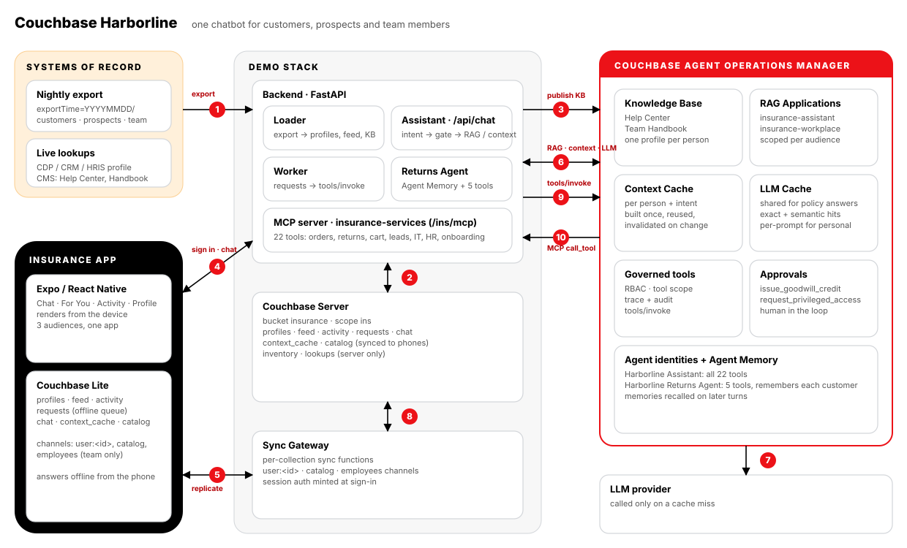
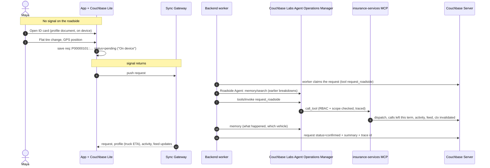
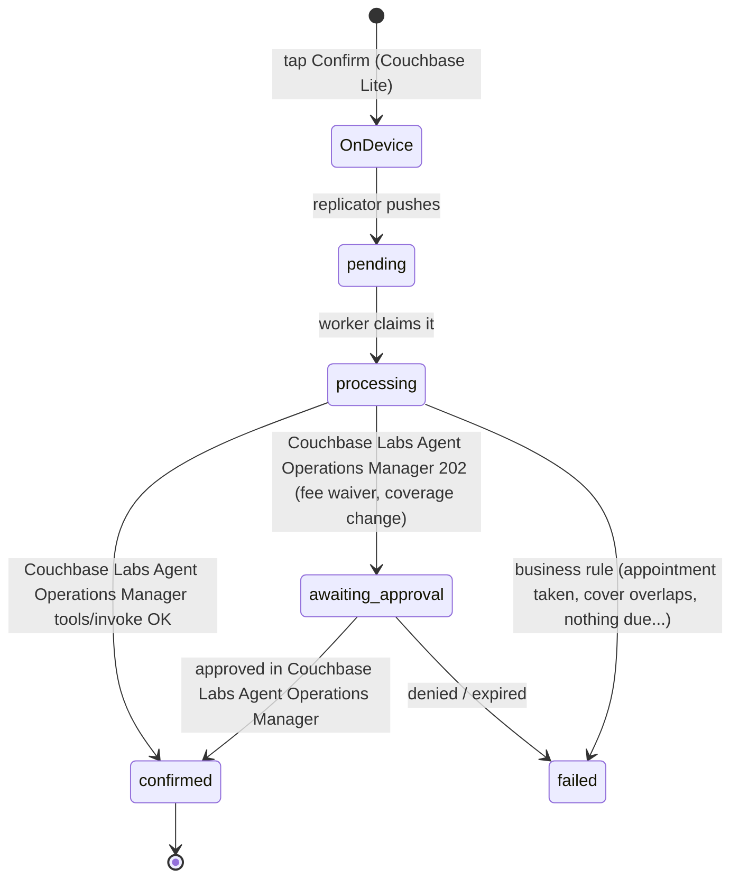

# Couchbase Harborline · Insurance Mobile AI Personalization Demo

An insurance app that knows the customer, works with no signal, and hands every action to a governed AI agent. **Harborline** is a fictional personal-lines insurer (auto, home, renters, health, pet and cover by the day). One mobile app serves three kinds of customer and covers the eight things people use an insurance app for:

| # | Use case | In the app | Agent that runs it |
|---|---|---|---|
| 1 | **Digital insurance cards & documents** | *ID cards & documents*: wallet-style ID cards, declarations, booklets, certificates. All stored on the phone; request a lender letter or a mailed card | Harborline Assistant |
| 2 | **Claims filing & tracking** | *Claims*: photos and video at the scene, submit on the spot, then a step-by-step tracker with the adjuster, estimate and payout | Claims Agent |
| 3 | **Roadside & emergency assistance** | *Roadside & emergency*: tow, flat tire, jump-start, lockout, fuel sent to the phone's GPS position; SOS for an accident, a medical emergency or trouble while travelling | Roadside Agent |
| 4 | **Premium payments & renewals** | *Payments & renewals*: pay now, AutoPay, accept a renewal monthly or in full, ask for a late-fee waiver; payment and renewal reminders in *For You* | Billing Agent |
| 5 | **Telematics & usage-based tracking** | *DriveWell*: join Safe Driver or Pay-Per-Mile, record trips, see the score and its factors, apply the earned discount to the renewal | DriveWell Agent |
| 6 | **In-app support & chatbot** | *Chat* (24/7 assistant) and *Support*: update personal details, request a policy or coverage change, bring in a licensed human agent | Harborline Assistant |
| 7 | **Health & wellness** | *Health & wellness*: book telehealth, track the deductible, upload a vet bill for a pet plan, link a wearable for premium credit | Wellness Agent |
| 8 | **Short-term, on-demand coverage** | *On-demand cover*: borrowed-car, rental-car, trip and one-day event cover, bought and activated from the phone | Coverage Agent |

It is built on the [OneChat demo](https://github.com/Couchbase-Field-Engineering/couchbase-onechat-mobile-ai-personalization-demo) framework and the same Couchbase stack: **Couchbase Lite** on the phone, **Sync Gateway**, **Couchbase Server**, and the **Couchbase Labs Agent Operations Manager** for the AI plane.

* Answers are grounded in Couchbase Labs Agent Operations Manager's **Knowledge Base**: a Help Center for everyone, a Member Care Guide for health and pet members only, and one profile document per person.
* Harborline is registered as two Couchbase Labs Agent Operations Manager **RAG Applications** (`insurance-assistant`, `insurance-wellness`), so queries, cache hits and savings show per audience.
* The context built for each personal answer is cached in Couchbase Labs Agent Operations Manager's **Context Cache** and in Couchbase, which syncs it to the phone for offline answers.
* LLM calls go through Couchbase Labs Agent Operations Manager's **LLM Caching** gateway: "How do I file a claim?" is paid for once and is free for the next person.
* Every action is an RBAC-checked, traced and audited Couchbase Labs Agent Operations Manager **tool call**, run by the agent that owns that use case. Each specialist is limited to its own tools (the Billing Agent cannot file a claim) and uses **Agent Memory** to recall and record what happened.
* Late-fee waivers wait for a billing supervisor and coverage changes for an underwriter in Couchbase Labs Agent Operations Manager's **approval tier**.

---

## What the demo shows

| Concept | Where you see it |
|---|---|
| **One app, three kinds of customer** | Sign in as a policyholder, a health and pet member, or an on-demand customer: the chat starters, *For You* cards, activity list and available screens all change. The phone only ever holds that person's documents. |
| **Personalization** | *For You* is ranked from last night's export (propensity scores, segments, policies) and re-ranked live after every action: a truck on the way goes to the top, a paid bill drops out, a DriveWell score turns into a renewal discount. |
| **Offline first** | Every screen renders from the on-device database. *Profile → Offline mode* pauses replication: the ID card still opens, a claim with photos or a tow request is saved as a `requests` document ("On device"), and the assistant answers from the phone. |
| **Members-only knowledge** | The Member Care Guide lives in its own RAG application and its own Sync Gateway channel (`members`). Someone without a health or pet plan who asks about telehealth gets a polite refusal with nothing retrieved (`restricted: true`), and the document is never on their phone. |
| **Couchbase Labs Agent Operations Manager RAG Applications** | Shared questions ("How do I file a claim?") go to `POST /v1/agent/rag/<app>/query`: retrieval cache, Knowledge Base search scoped to one document, LLM cache. |
| **Context Caching** | Personal questions ("What's the status of my claim?") assemble context once per person and intent (profile document, policy passages, governed tool results) and store it in Couchbase Labs Agent Operations Manager's Context Cache and in `context_cache` in Couchbase. Follow-ups reuse it; any change to the person's data invalidates it. |
| **LLM Caching** | Shared answers contain no personal data, so they are reused across everyone. The chat shows a chip for each: `Context cache · built / hit`, `LLM cache · miss / exact / semantic`. |
| **Seven agents, one tool server** | 28 tools on the `insurance-services` MCP server, called through `POST /v1/tools/invoke`. The assistant answers and handles documents and support; six specialists run the rest, each with its own Couchbase Labs Agent Operations Manager identity, tool scope and Agent Memory. |
| **Human approval** | `request_fee_waiver` and `request_coverage_change` return `202 pending_approval`: the phone shows **Awaiting approval** until someone decides on Couchbase Labs Agent Operations Manager's *Approvals* page. |

### The agents

| Agent (Couchbase Labs Agent Operations Manager id) | Triggered by | Tools beyond the two shared reads |
|---|---|---|
| Harborline Assistant (`insurance-assistant`) | Every chat turn; documents and support requests | all 8 read tools; `request_document`, `update_contact_details`, `request_policy_change`, `request_coverage_change`, `request_live_agent` |
| Claims Agent (`insurance-claims-agent`) | `file_claim`, `add_claim_evidence` | `get_claims` |
| Roadside Agent (`insurance-roadside-agent`) | `request_roadside`, `send_sos` | `get_roadside_status` |
| Billing Agent (`insurance-billing-agent`) | `make_payment`, `set_autopay`, `renew_policy`, `request_fee_waiver` | `get_billing` |
| DriveWell Agent (`insurance-drive-agent`) | `enroll_telematics`, `record_trip`, `redeem_drive_discount` | `get_driving_summary` |
| Wellness Agent (`insurance-wellness-agent`) | `book_telehealth`, `submit_vet_bill`, `link_wearable` | `get_wellness_summary` |
| Coverage Agent (`insurance-coverage-agent`) | `activate_coverage` | `get_coverage_options` |

Every specialist can also call `get_customer_context` and `get_policies`. One request is one Couchbase Labs Agent Operations Manager run: the specialist recalls what Couchbase Labs Agent Operations Manager remembers about this customer in its domain (`POST /v1/memory/search`), invokes the tool, and writes an episodic memory of the outcome (`POST /v1/memory`). The assistant recalls the same memories on its next turn. Definitions are in [`backend/app/agents.py`](backend/app/agents.py).

---

## Architecture



| # | Flow |
|---|---|
| **1** | Every night an `exportTime=YYYYMMDD` JSON Lines partition of policyholders, members and on-demand customers lands in the export folder. The loader picks up the newest one with a `_SUCCESS` marker. |
| **2** | The loader upserts every profile, builds each person's *For You* feed, and publishes the catalog (and the members-only guide) in Couchbase Server. |
| **3** | The loader replaces the Couchbase Labs Agent Operations Manager **Knowledge Base** documents (Help Center, Member Care Guide, one profile per person up to `KB_PROFILE_LIMIT`) and re-scopes the two **RAG Applications** to today's documents. |
| **4** | Sign-in: the backend creates the person's Sync Gateway user (channels `user:<id>`, `catalog`, plus `members` for health and pet members) and mints a session. |
| **5** | **Couchbase Lite** replicates continuously with Sync Gateway. Every screen renders from the phone; taps become `requests` documents saved locally. |
| **6** | Chat goes to `/api/chat`. Shared questions go to the audience's RAG Application in one call. Personal questions check Couchbase Labs Agent Operations Manager's Context Cache; on a miss the assistant builds context from the Knowledge Base, the system of record and read-only tools, then caches it. |
| **7** | Couchbase Labs Agent Operations Manager calls the LLM provider only on a cache miss. |
| **8** | Sync Gateway carries requests up and results back down. |
| **9** | The worker hands each request to the agent that owns its tool, which runs it through `POST /v1/tools/invoke`, so RBAC, tool scope, the approval tier, a trace and an audit entry are applied. |
| **10** | Couchbase Labs Agent Operations Manager calls the `insurance-services` MCP server, which applies the change in Couchbase; the updated profile, activity and feed sync back to the phone. |

### A breakdown with no signal, end to end



### Offline-first request lifecycle



---

## Quick start

### 1. Browser preview in about 2 minutes (no Docker, no Couchbase Labs Agent Operations Manager)

The backend can run on an in-memory store, and the app has a browser preview engine that syncs the same documents over REST. Use this to look at the UX; Couchbase Lite needs a device build (step 3).

```bash
python3 datagen/generate_mock_export.py             # 24 MiB export → data/insurance-export/exportTime=<today>/
cd backend && python3 -m venv .venv && . .venv/bin/activate && pip install -r requirements.txt
uvicorn app.main:app --port 8200                    # STORE_DRIVER=memory by default
# new terminal
cd mobile && npm install && npx expo start --web    # sign in with a demo persona
```

Without Couchbase Labs Agent Operations Manager the assistant writes its answers itself from the same context and the tools run in-process, so every flow works. The request tracker then says "ungoverned", there is no Agent Memory, and the two approval-tier tools apply immediately instead of waiting for a person.

### 2. Full stack: Couchbase, Sync Gateway and Couchbase Labs Agent Operations Manager

You need Docker Desktop, and the [Couchbase Labs Agent Operations Manager](https://github.com/erikhinderer/couchbase-agent-operations-manager) running on the same machine at `https://localhost:8090` with its admin password set.

```bash
python3 datagen/generate_mock_export.py
cp .env.example .env
./scripts/setup-corporate-ca.sh            # only behind a TLS-inspecting proxy (Zscaler etc.)
docker compose up -d --build               # couchbase, init, sync-gateway, sg-init, backend, web
docker compose logs -f backend             # wait for "Loaded export …"

python3 scripts/register_with_aom.py --admin-password '<Couchbase Labs Agent Operations Manager admin password>'
docker compose up -d --build backend       # picks up AOM_* from .env, publishes the KB, scopes the RAG apps
```

`register_with_aom.py` is idempotent; `--rotate` issues new agent keys. After it runs, Couchbase Labs Agent Operations Manager shows:

* **Agents**: *Harborline Assistant* and the six specialists (keys written to `.env` as `AOM_AGENT_API_KEY` and the JSON map `AOM_SPECIALIST_AGENT_KEYS`)
* **Servers / Catalog**: `insurance-services` (trusted) and its 28 tools
* **Knowledge**: the Help Center, the Member Care Guide and per-person profile documents
* **Approvals config**: `request_fee_waiver` and `request_coverage_change` require a human
* **RAG Applications**: `insurance-assistant` (Help Center) and `insurance-wellness` (Member Care Guide)
* **Context Cache**: entries in `rag:<app>:user-context`, one per person and intent

Configure an LLM provider key in Couchbase Labs Agent Operations Manager to get generated answers. Without one, Couchbase Labs Agent Operations Manager returns a labelled stub, the backend writes the answer from the same retrieved context, and Couchbase Labs Agent Operations Manager still reports the cache status.

| Port | Service |
|---|---|
| `5156` | **The app in a browser** over HTTPS, behind the sign-in page, inside a phone frame (`?frame=0` for full width), and the story at `/story` |
| `8204` | Backend API + MCP server (`/ins/mcp`); `/` lists every link |
| `4990` | Sync Gateway public, which is what phones replicate with: `ws://<host>:4990/insurance` |
| `127.0.0.1:4991` | Sync Gateway admin |
| `127.0.0.1:18094` | Couchbase Web Console (Administrator / password123) |

**Sign-in and HTTPS.** The browser UI (the app, the story page and everything else the `web` container serves) is on **`https://<host>:5156`** and opens on a sign-in page:

| Username | Password |
|---|---|
| `demo` | `Couchbase123!` |

Change them with `DEMO_USERNAME` / `DEMO_PASSWORD` in `.env` (Compose) or `web.auth.username` / `web.auth.password` (Helm). The container serves a self-signed certificate it generates on first start, so the browser warns once; add the address people use to `TLS_HOSTS` (Compose) so it is in the certificate, or serve a real one by mounting `tls.crt` / `tls.key` at `/etc/nginx/tls` (Helm: `web.tls.secretName`). Plain `http://` on the same port redirects to HTTPS, and `/signout` ends the session. The sign-in covers the browser UI only: the backend API and Sync Gateway ports are unchanged.

The ports are chosen so this stack runs alongside Couchbase Labs Agent Operations Manager and the OneChat demo (5150 / 8202 / 4988).

### 3. The app on a device with Couchbase Lite

Couchbase Lite is a native module, so it needs a **development build**; Expo Go can't load it. `npm install` runs `scripts/fetch-cbl-native.sh`, which fetches the `cbl-reactnative` native submodules that npm skips.

```bash
cd mobile
cp .env.example .env                       # API + Sync Gateway URLs (LAN IP for a physical phone)
npm install
npx expo run:ios -d "iPhone 16 Pro"        # or: npx expo run:android
```

With `EXPO_PUBLIC_DB_ENGINE=auto` the app uses Couchbase Lite whenever the native module is linked. *Profile → Offline & sync* shows the database, the Sync Gateway endpoint, the replicator status and how many documents are waiting to send.

The `web` service serves a prebuilt browser bundle (`web/dist.tgz`). After changing the app, rebuild it with `cd mobile && npm run export:web:docker`, then `docker compose up -d --build web`.

### 4. Kubernetes with Helm (K3s / Rancher)

`deploy/k8s/deploy.sh` deploys Couchbase Labs Agent Operations Manager (**agent-ops**) and this demo (**insurance-app**) onto a single-node K3s cluster without a container registry:

```bash
AOM_ADMIN_PASSWORD='<12+ characters>' ./deploy/k8s/deploy.sh
AOM_ADMIN_PASSWORD='<current Couchbase Labs Agent Operations Manager password>' ONLY=insurance ./deploy/k8s/deploy.sh   # Couchbase Labs Agent Operations Manager is already there
```

It builds the images, copies them over SSH into K3s's containerd, and runs `helm upgrade --install` for [`helm/insurance-app`](helm/insurance-app) with [`deploy/k8s/values-mother.yaml`](deploy/k8s/values-mother.yaml). In the cluster the backend registers itself with Couchbase Labs Agent Operations Manager (`AOM_AUTO_REGISTER=true`): it adds the MCP server, issues the seven agent identities, turns on the approval tier and publishes the Knowledge Base and RAG applications. Progress is in `/api/status` under `aom.registration`. A CronJob writes a new export partition every morning and the backend picks it up. `deploy/k8s/diagnose.sh` prints the state of every piece.

---

## Demo script (about 12 minutes)

Sign in with the account number and last name (the sign-in screen lists them). The demo clock is the export date, so "renews in 21 days" reads the same whenever you run it.

1. **Maya Chen** · policyholder, auto + home · `5510101` / `Chen`
   * *For You*: her claim estimate is ready, the auto policy renews in 21 days, $158 is due in 4 days, and her DriveWell score of 88 is worth 15% off.
   * *Chat*: "How do I file a claim?" → `LLM cache · miss`. "What's the status of my claim?" → `Context cache · built`, the adjuster and estimate, and a **Track** action. Ask again: `Context cache · hit`.
   * *ID cards & documents*: the auto ID card with both vehicles. *Profile → Offline mode* **on**: the card still opens.
   * Still offline, *Roadside & emergency* → **Flat tire change**: it is saved **On device**. Ask "I have a flat tire" in Chat: **Answered on device**. Switch offline mode **off**: the request syncs, the Roadside Agent dispatches, and *For You* leads with the truck's ETA. In Couchbase Labs Agent Operations Manager, show the trace for `insurance-services::request_roadside` and the agent's memory.
   * *Claims* → **File a new claim** (windshield, two photos) → the Claims Agent files it. *DriveWell* → **Save trip** → the score moves. *Payments & renewals* → **Apply** the DriveWell discount, then **Renew**.
   * *Support* → *Change a policy* → **Add a driver**: **Awaiting approval** until an underwriter approves it in Couchbase Labs Agent Operations Manager → *Approvals*.
   * "Can I book a telehealth visit?" is refused: members-only knowledge is not in her scope.
2. **Daniel Okafor** · member, health + pet plans · `5520202` / `Okafor`
   * "How do I file a claim?" → **LLM cache exact hit** from Maya's question: shared knowledge, no personal data.
   * *For You*: the pet premium is past due. *Payments & renewals* → ask for the **late-fee waiver** → **Awaiting approval** for a billing supervisor.
   * *Health & wellness*: book a telehealth visit (two phones can't take the last appointment: the slots are a CAS-protected document), see $640 of the $1,500 deductible met, submit a $240 vet bill for Biscuit ($64 back after the deductible), link an Apple Watch for 500 points.
   * "How much of my deductible have I met?" → answered, from the question Maya was refused.
3. **Sofia Alvarez** · on-demand customer, no annual policy · `5530303` / `Alvarez`
   * *For You*: she borrows a Toyota RAV4 tomorrow and flies to Lisbon in 9 days. Both offers are priced for her plans.
   * *On-demand cover* → **Activate** borrowed-car cover ($36 for 3 days). The certificate appears under *ID cards & documents*, and roadside is included while it is active.
   * Protect the Lisbon trip ($144): trip cancellation, emergency medical and the 24/7 SOS line.

## Company workload: the caches under load

Three personas show how the caches work; the workload shows what they do to a real queue. `POST /api/demo/workload` (the **Run company workload** button on the story page, or the script) plays people from all 9 groups (five policyholder regions, health members, pet members, on-demand drivers and travellers) against the assistant through the same path the phone uses.

```bash
python scripts/run_chatbot_workload.py --backend http://localhost:8204 --aom https://localhost:8090
python scripts/run_chatbot_workload.py --users-per-group 6 --turns 8 --concurrency 8 --groups POL-NE,MEM-PET,OD-TRAVEL
python scripts/run_chatbot_workload.py --plan               # who asks what, without running
python scripts/run_chatbot_workload.py --hours 24           # paced to a day/night traffic curve
python scripts/run_chatbot_workload.py --status | --stop
```

Shared questions are drawn Zipf-style, so a few dominate: the canonical wording gives **exact hits** after the first person pays, `--paraphrase-ratio` of people reword it (**semantic hits**), the long tail misses. Personal questions build context once per person and intent, then hit. Statements go to Agent Memory. The report is broken down by group, area, use case and cache outcome (`GET /api/demo/workload`), and the story page shows it live.

## Reset the demo

`POST /api/demo/reset` (the **Reset demo** button, or `python scripts/reset_demo.py`) puts the three personas, plus everyone who changed something since the load, back to today's export: requests, chat and cached context are deleted, profiles reloaded, telehealth appointments released, feeds rebuilt, and their Couchbase Labs Agent Operations Manager memories and Harborline's cache namespaces purged. Sync Gateway replicates the result to the phone. `--dry-run` shows who would be reset.

---

## Data model

Bucket `insurance`, scope `ins`. Sync Gateway replicates the first seven collections to Couchbase Lite under the same names.

| Collection | Document | Written by | Notes |
|---|---|---|---|
| `profiles` | `profile::<user>` | loader, actions | The export row + `rev` (bumped on every change): policies with ID cards and documents, claims, billing, roadside, telematics, wellness, on-demand cover |
| `feed` | `feed::<user>` | personalization | Ranked *For You* cards, each with a call to action and what its screen needs offline (telehealth slots, on-demand quotes) |
| `activity` | `activity::<user>` | actions | What was done in the app: claims, dispatches, payments, trips, visits, cover |
| `requests` | `req::<user>::<uuid>` | **the phone** (create), worker (status) | Offline-first queue; the sync function allows only the owner to create a `pending` request |
| `chat` | `chat::<user>` | assistant | History, plus answers reusable offline |
| `context_cache` | `ctx::<user>::<intent>` | assistant | Phone copy of the Couchbase Labs Agent Operations Manager Context Cache entry |
| `catalog` | `catalog::v1`, `wellness::v1` | loader | Products, forms and the Help Center FAQ (channel `catalog`); the Member Care Guide (channel `members`) |
| `inventory` | `inv::v1` | actions | Open telehealth appointments. Server only |
| `lookups` | login index, KB document ids, load state | loader | Server only |

Tools on `insurance-services`: read-only `get_customer_context`, `get_policies`, `get_claims`, `get_roadside_status`, `get_billing`, `get_driving_summary`, `get_wellness_summary`, `get_coverage_options`; actions `request_document`, `update_contact_details`, `request_policy_change`, `request_coverage_change` (approval), `request_live_agent`, `file_claim`, `add_claim_evidence`, `request_roadside`, `send_sos`, `make_payment`, `set_autopay`, `renew_policy`, `request_fee_waiver` (approval), `enroll_telematics`, `record_trip`, `redeem_drive_discount`, `book_telehealth`, `submit_vet_bill`, `link_wearable`, `activate_coverage`.

## Configuration

Backend variables go in `.env` (see `.env.example`); `docker-compose.yml` sets the infrastructure ones.

| Variable | Default | |
|---|---|---|
| `STORE_DRIVER` | `memory` (compose: `couchbase`) | `memory` keeps up to `MEMORY_MAX_PROFILES` people |
| `AOM_URL`, `AOM_AGENT_API_KEY` | — | Assistant agent identity, written by `register_with_aom.py` |
| `AOM_SPECIALIST_AGENT_KEYS` | — | JSON map of specialist agent id → key; a specialist without a key runs as the assistant, without memory |
| `AOM_ADMIN_USERNAME`, `AOM_ADMIN_PASSWORD` | — | Used to publish KB documents |
| `AOM_LLM_PROVIDER`, `AOM_LLM_MODEL` | Couchbase Labs Agent Operations Manager default | Pin the model completions use |
| `RAG_APP_ID`, `RAG_APP_ID_WELLNESS` | `insurance-assistant`, `insurance-wellness` | Couchbase Labs Agent Operations Manager RAG Application ids |
| `KB_PROFILE_LIMIT` | `150` | How many people get a KB profile document |
| `EXPORT_DIR`, `EXPORT_POLL_SECONDS` | `data/insurance-export`, `600` | Where the nightly export lands and how often to look |
| `DEMO_TODAY` | the export date | The demo's notion of today |
| `SOR_PROFILE_API_URL`, `SOR_API_TOKEN`, `SOR_MOCK_LATENCY_MS` | — | Live profile lookup against the system of record (blank = mock from the export) |
| `CMS_KB_ENDPOINT`, `CMS_TOKEN` | — | Help Center / Member Care Guide source (blank = bundled articles) |
| `SG_PUBLIC_URL` | — | Replication URL handed to phones |

App variables (`mobile/.env`): `EXPO_PUBLIC_API_URL`, `EXPO_PUBLIC_SG_URL`, `EXPO_PUBLIC_DB_ENGINE` (`auto` · `cbl` · `preview`).

## Tests

```bash
cd backend && pip install -r requirements.txt && pytest -q    # 34 tests
cd mobile && npm run typecheck
```

`test_demo_flows.py` covers the eight use cases across the three personas, the members-only gate, the context cache (hit, then invalidation after a change), the offline request flow, business-rule failures and push authorization. `test_aom_integration.py` and `test_aom_bootstrap.py` run the backend against `tests/fake_aom.py`, which has the same routes and shapes as Couchbase Labs Agent Operations Manager: KB publishing, both RAG applications and their scopes, the shared LLM cache, tool calls over real MCP, the approval tier and the specialist agents with memory.

## Repository layout

```
backend/            FastAPI API, MCP server, loader, worker, assistant (Python)
  app/catalog.py          Harborline reference data: lines, coverages, claims, roadside, telematics, plans, on-demand products
  app/assistant.py        intent → members gate → Couchbase Labs Agent Operations Manager RAG app (shared) | Context Cache → KB + memory + LLM cache (personal) → actions
  app/agents.py           the six specialist agents: tool scope, memory recall, governed call, remember the outcome
  app/actions.py          business logic behind all 28 tools
  app/personalization.py  For You cards per customer
  app/knowledge.py        Help Center, Member Care Guide and profile documents for the Knowledge Base
  app/rag_app.py          the two Couchbase Labs Agent Operations Manager RAG Application definitions
  app/loader.py           nightly export → Couchbase + Couchbase Labs Agent Operations Manager Knowledge Base
  app/sources.py          systems of record: live profile lookup and CMS, mock or live
  app/worker.py           offline-first requests → the owning agent → Couchbase Labs Agent Operations Manager tools/invoke
  app/workload.py         company workload;  app/demo_reset.py  reset;  app/aom_bootstrap.py  self-registration
mobile/             Expo app (Couchbase Lite engine + browser preview engine)
  app/(tabs)/             Chat, For You, Activity, Profile
  app/*.tsx               one screen per use case: cards, claim, roadside, pay, drive, support, wellness, coverage
  src/features/assistant/offline.ts   the assistant's answers from Couchbase Lite when there is no connection
  src/insurance.ts        the rules the screens need offline (amount due, roadside plan, quotes, DriveWell discount)
datagen/            mock nightly export generator
couchbase-init/     bucket / scope / collections / indexes
sync-gateway/       bootstrap + database config with per-collection sync functions
scripts/            register_with_aom.py, run_chatbot_workload.py, reset_demo.py, setup-corporate-ca.sh
web/                nginx image: the browser build of the app and the story page (proxies /api to the backend)
helm/insurance-app/ Helm chart (Couchbase, Sync Gateway, backend, daily export CronJob, web)
deploy/k8s/         deploy scripts + values for the K3s node
data/               the export landing folder
```

## What is simulated

* **Camera.** Photo, video and invoice capture are stand-ins: the app records how many were taken and sends the count with the claim or vet bill. No image is stored or uploaded. Wire `expo-image-picker` and Couchbase Lite blobs in for real attachments.
* **GPS.** Roadside and SOS use the platform's geolocation where there is one (the browser preview asks for permission) and otherwise the last location in the profile or a typed address. A device build needs `expo-location` for a live fix.
* **Telematics.** *Record a trip* sends one of four sample trip summaries; nothing reads the phone's motion sensors.
* **Push notifications.** Payment and renewal reminders are *For You* cards that arrive by replication. No push service is configured.
* **Payments, dispatch, telehealth, wearables.** No payment processor, towing network, clinician platform or wearable API is called; the MCP tools update Couchbase and return realistic results.
* **Live agent.** Requesting a licensed agent records the hand-off and names an agent; no human chat session opens.

## Notes

* **Harborline is fictional.** The company, its policies, prices, coverages and people are invented demo data, not insurance advice.
* **Brand.** Colors, shapes and the logo follow couchbase.com (black, white, red `#EC1218`). The logo files in `mobile/assets/brand/` are Couchbase's; headings use Inter / the system font in place of Couchbase's licensed Centra No2.
* **Couchbase licensing.** Couchbase Server EE and Sync Gateway EE images run under the free developer license for dev and test. Shipping Couchbase Lite with encryption requires an Enterprise license.
* **Credits.** `plugin.config.js`, `plugin.fmt.js`, `metro.config.js` and the two `mobile/scripts` come from [mobile_field_service](https://github.com/Fujio-Turner/mobile_field_service) (Apache-2.0).
